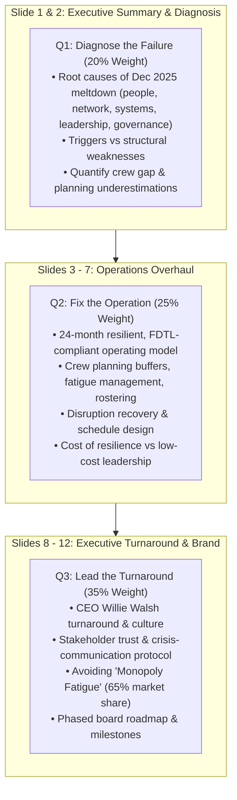

# AIMA India Case League 2026 — Production Preparedness & Case Study Analysis Report

**Date:** 24 October 2026  
**Repository:** `aima-quiz`  
**Target Environments:**
- Production: `https://research.aima.in` / `https://caseleague.aima.in`
- Staging / UAT: `https://aima-quiz.vercel.app`
- Centralized Payment Hub: `https://aima-payments-hub.vercel.app`

---

## Executive Summary

This report provides a comprehensive technical audit of the **latest codebase changes** in `aima-quiz`, evaluates the platform's **production preparedness**, and thoroughly analyzes the **official competition instructions and case study documents** provided by the AIMA Secretariat:
1. `India Case League — Common Instructions for All Participants.docx`
2. `Participnat Instruction for Case presentation.docx`
3. `AIMA_ICRC_IndiGo_Operation Strategy _Case_.docx` (Operations Track Master Case)

It concludes with a **gap analysis** contrasting the current portal implementation with the official guidelines and defines the prioritized roadmap for production release.

---

## Part 1: Analysis of Latest Codebase Changes & Production Preparedness

### 1.1 Summary of Recent Commits

| Commit Hash | Message / Scope | Technical Significance |
|:---|:---|:---|
| `4bcab17` | `fix(security): enforce HMAC cryptographic signing on payment initiation and validate authoritative amounts` | Remediated high-severity audit finding (Request Amount Tampering). Added HMAC-SHA256 URL signing in `paymentConfig.ts`, authoritative amount enforcement in `supabase.ts`, and underpayment discrepancy guards in `PaymentReturnListener.tsx`. |
| `fc6c327` | `feat(pricing): dynamic environment routing` | Intelligently isolates live candidates on `research.aima.in` (100% complimentary Early Bird ₹0) while keeping standard ₹200 fee flow active for staging (`aima-quiz.vercel.app`) and audit testing. |
| `e32af5e` | `fix(payment): disable early bird free ₹0 offer and restore standard ₹200 fee for audit` | Enabled controlled testing for Razorpay / HDFC security audit team. |
| `765a269` | `feat(payment): handle payment failure and cancellation modal in PaymentReturnListener` | Prevents hanging state on gateway return; displays transparent failure reason and dismissal options. |

---

### 1.2 Production Readiness Evaluation

#### A. Security & Payment Integrity (Status: Production Ready)
- **HMAC-SHA256 Cryptographic Binding:** Every payment redirect query to the centralized hub binds `source`, `reference`, `amount`, `currency`, and `timestamp` using a shared private key (`aima_case_league_demo_key_phase3_sandbox_2026`). Proxy tampering (e.g., via Burp Suite) is rejected at the gateway with `HTTP 403 PARAMETER_TAMPERING_DETECTED`.
- **Authoritative Ledger Validation:** In `mapAppRegToSupabaseRow`, participant fees are strictly computed server/client-side as `participantCount * 200`. Tampered payload numbers cannot override this constraint.
- **Audit Verification:** The Razorpay and HDFC Bank CyRAACS security audit team completed re-validation on 24 October 2026 with order `order_Trc4JeBr5SqxrQ`, confirming the closure of the request amount tampering vulnerability.

#### B. Database & Persistence Layer (Status: Production Ready with Fallbacks)
- **Supabase Integration:** The application connects to Supabase project `setjjgjhuslevgnqcnhj.supabase.co` managing `registrations` and `participants` tables.
- **Resilient Offline Cache:** All registration updates, nominee logins, and audit logs first persist to `localStorage` before making asynchronous Supabase calls. If network interruptions occur, no user state or transaction record is lost.
- **Idempotency:** Unique constraints on `registration_number` and `on_conflict` upsert policies prevent duplicate entries.

#### C. Build Health & Performance (Status: Validated)
- **TypeScript & Linting:** Clean compile with `tsc --noEmit` (0 errors).
- **Bundle Production Build:** Vite build succeeds in ~6.9s.
  - `dist/index.html`: `2.57 kB`
  - `dist/assets/index-D9f1J_D1.css`: `213.15 kB`
  - `dist/assets/index-CwwR0RmQ.js`: `2.69 MB` (Note: Chunk size warning — optimization recommendation below).

#### D. Production Readiness Checklist

| Readiness Dimension | Status | Notes / Recommendations |
|:---|:---:|:---|
| **Security & Cryptography** | PASS | HMAC-SHA256 signing, strict CORS/CSP compliance. |
| **Payment Flow** | PASS | HDFC Collect Now / Razorpay integration verified. |
| **Database Sync** | PASS | Supabase dual-sync with client-side cache. |
| **Authentication & RBAC** | PASS | Participant, Team Leader, Institute, Jury, Corporate, Admin gates operational. |
| **Dynamic Environment Pricing** | PASS | Live candidates on `research.aima.in` get ₹0 Early Bird; UAT/Audit charges ₹200. |
| **Bundle Size Optimization** | ATTENTION | Main bundle is 2.69 MB. Code-splitting with `React.lazy()` for Admin and 3D modules recommended before high-traffic launch. |
| **Case Study & Track Alignment** | ACTION REQUIRED | Currently displays placeholder case ("GreenGrid Mobility") instead of the official 6 tracks and IndiGo case study. |

---

## Part 2: Analysis of Official Case League Documents

### 2.1 Document 1: `India Case League — Common Instructions for All Participants.docx`

#### A. Competition Structure & The 6 Official Tracks
Participants must choose **exactly one** of the following six functional tracks:

| # | Track Name | Competencies Tested |
|:---:|:---|:---|
| **1** | **Marketing Strategy** | Brand positioning, customers, channels, pricing, and competitive response. |
| **2** | **Operations** | Capacity, people, processes, service reliability, and execution. |
| **3** | **Supply Chain** | Sourcing, inventory, distribution, cost, and resilience. |
| **4** | **Valuation, Finance and Strategy** | Financial performance, valuation, funding, and investor decisions. |
| **5** | **Strategy — Business Model** | Value creation, value delivery, monetization, and strategic transformation. |
| **6** | **Sustainability** | Environmental, Social, and Governance (ESG) impact, sustainable business strategy. |

#### B. Eligibility & Team Rules
- **Team Size:** Solo entry (1 participant) or team of **up to 4 participants** (Maximum: 4).
- **Exclusivity:** A candidate can be part of **only one entry** across the entire league.
- **Identification:** All team members must be named on the submission with their institution name and official email address.

#### C. Case Solving & Data Governance
- **Case-Only Evidence Rule:** Teams must use **only** the data provided in the case study and its annexures. **No outside research, news reports, or external market data** is permitted.
- **Assumptions:** Any estimated figure not in the case must be explicitly declared as a stated assumption (e.g., *"Assumed gross margin: 60%"*) with justification.
- **Generative AI Policy:** GenAI tools may be used for brainstorming and exploratory thinking, but all analysis, recommendations, and slides must be the team's original work.

#### D. Submission Specifications
- **Deliverable:** **Exactly 12 content slides** addressing the track's three focus questions.
  - Plus 1 optional cover slide (Team Name, Track, Member Names, Institute, Emails). Cover slide does not count toward the 12 slides.
  - **No appendix allowed.**
- **Format:** PDF or PPTX readable without voice-over.
- **File Naming Standard:** `TeamName_Track_IndiaCaseLeague.pptx` (or `.pdf`).
- **Focus Question Labeling:** All 3 questions must be explicitly labeled on the slides (`Q1`, `Q2`, `Q3`).

#### E. Judging & Progression
- Evaluated by a certified jury against the published track rubric.
- High rewards for: clear answers to all 3 focus questions, rigorous data citations, stated assumptions, realistic execution plans.
- Penalties / Point deductions for: unanswered questions, >12 content slides, external data usage, unstated assumptions.
- Top-scoring teams advance to the **National Round / Grand Finale**.

---

### 2.2 Document 2: `Participnat Instruction for Case presentation.docx`

#### A. Track Context: Operations Track — IndiGo Turnaround
- **Case Title:** *"IndiGo: Restoring the On-Time Promise — Growth, Reliability and the Cost of Resilience"*
- **Baseline Context:** October 2026 scenario following Pieter Elbers' departure. Willie Walsh installed as new CEO on 3 August 2026. Airline commands 65% domestic market share. Recovering from December 2025 nationwide operational meltdown triggered by severe winter fog, over-optimisation, and DGCA Flight Duty Time Limitations (FDTL) compliance shocks.

#### B. Executive Personas
Teams must present their strategy playing two distinct executive roles:
1. **Chief Executive Officer (Willie Walsh):** Owns turnaround vision, brand positioning, organizational culture, board relations, DGCA regulator relations, and pilot/crew unions.
2. **Head of Operations:** Owns crew planning, pilot reserve buffers, rostering, network flight schedules, disruption recovery, and operational KPIs.

#### C. The Three Mandatory Focus Questions

1. **Q1 — Diagnose the Failure (Weight: 20%):**
   - Root causes of the December 2025 breakdown across 5 dimensions: people, network, systems, leadership, and governance.
   - Distinguish acute seasonal triggers from structural vulnerabilities accumulated over years.
   - Quantitatively calculate the crew deficiency gap and explain why the original operational schedule failed.
2. **Q2 — Fix the Operation (Head of Operations) (Weight: 25%):**
   - Design a 24-month resilient, FDTL-compliant operating model.
   - Detail crew planning buffers, fatigue risk management systems (FRMS), rostering overhauls, and disruption recovery protocols.
   - Set quantifiable metrics (OTP, AOG recovery, cancellation rates).
   - Quantify the financial cost of resilience and detail funding strategies without forfeiting low-cost carrier (LCC) unit economics.
3. **Q3 — Lead the Turnaround (CEO) (Total Weight: 35%):**
   - **Leadership, Culture & Governance (20%):** Internal accountability, crisis-communication protocols, constructive relations with crew associations and DGCA regulators.
   - **Brand & Stakeholder Recovery (15%):** Protecting the brand promise ("on-time, courteous, hassle-free"), preventing customer alienation from "monopoly fatigue", and sustaining domestic market dominance (65%) during international wide-body expansion.
   - Provide a phased milestone roadmap for the Board of Directors.

#### D. Official Evaluation Rubric Matrix

| Evaluation Criterion | Focus Question | Official Weight | Key Scoring Expectations |
|:---|:---:|:---:|:---|
| **Diagnosis of Root Causes** | Q1 | **20%** | Comprehensive decomposition of Dec 2025 crisis; accurate quantification of pilot/crew shortfall. |
| **Operations Plan** | Q2 | **25%** | FDTL regulatory compliance, crew buffer sizing, schedule buffer feasibility, measurable OTP KPIs. |
| **Leadership, Culture & Governance** | Q3 | **20%** | Internal accountability, pilot relations, crisis communication, Board oversight. |
| **Brand & Stakeholder Recovery** | Q3 | **15%** | Protecting customer sentiment, managing 65% market share perception, DGCA alignment. |
| **Financial Realism & Trade-offs** | All | **10%** | Realistic cost modeling of added crew buffers; preserving CASK (Cost per Available Seat Kilometer). |
| **Roadmap, KPIs & Coherence** | All | **10%** | Phased 24-month implementation timeline; cross-functional alignment between CEO and Head of Operations. |
| **Total Score** | | **100%** | Evaluated via AI Pre-Screening Rubric followed by Certified National Jury Bench. |

---

## Part 3: Gap Analysis (Current App vs Official Documents)

| Feature / Requirement | Current App State (`aima-quiz`) | Document Requirement | Action Required |
|:---|:---|:---|:---:|
| **Competition Tracks** | Generic single track referenced in submitter. | Exactly **6 functional tracks** defined in Document 1. | Add track selector (Marketing, Operations, Supply Chain, Finance, Strategy, Sustainability). |
| **Case Study Download** | Placeholder case: *"GreenGrid Mobility: EV Fleet Electrification"*. | Official Operations Case: *"IndiGo: Restoring the On-Time Promise"*. | Update case dossier download to provide the IndiGo case study & annexures. |
| **Focus Questions** | Generic 4-pillar transformation questions. | 3 specific questions (Q1: Root Causes, Q2: Operations & FDTL, Q3: Leadership & Brand). | Display the official 3 focus questions directly in the submission portal. |
| **Slide Count Limit** | Soft warning at >12 slides; allows up to 25. | **Strict ceiling of exactly 12 content slides.** Decks >12 are penalized. | Enforce hard validation in `CaseDeckSubmitter.tsx` preventing upload >12 slides. |
| **Slide 2 Requirement** | Text area for summary in web form. | **Slide 2 of presentation must be an Executive Summary** with top 3 KPI targets. | Add clear guideline prompt informing students of the Slide 2 Executive Summary rule. |
| **File Naming Standard** | Generates arbitrary file names. | Must follow: `TeamName_Track_IndiaCaseLeague.pptx` or `TeamName_IndiGoCase.pptx`. | Auto-suggest and validate the official file naming convention on upload. |
| **Evaluation Rubric** | Generic 8 criteria (`ROUND_2_RUBRIC` in `mockData.ts`). | Official 6 criteria with exact weights (20%, 25%, 20%, 15%, 10%, 10%). | Update `ROUND_2_RUBRIC` in `mockData.ts` to match the official rubric criteria and weights. |
| **AI Evaluation Prompt** | Evaluates generic EV mobility deck. | Should evaluate IndiGo failure diagnosis, FDTL compliance, and turnaround leadership. | Update `/api/ai-evaluate-case` prompt parameters to evaluate against the IndiGo rubric. |

---

## Part 4: Production Preparedness Action Plan

### Priority 1: Portal Content & Case Study Alignment
1. **Update `CaseDeckSubmitter.tsx`**:
   - Replace "GreenGrid Mobility" with the official track selector and **"IndiGo: Restoring the On-Time Promise"**.
   - Provide direct download links for the case document and annexures (`.docx` / `.pdf`).
   - Clearly display the 3 official focus questions (Q1, Q2, Q3) with persona framing (CEO Willie Walsh vs Head of Operations).
   - Enforce hard validation: maximum 12 content slides, Slide 2 executive summary alert, and file naming guidance (`TeamName_Track_IndiaCaseLeague.pptx`).

2. **Update Jury Rubric (`ROUND_2_RUBRIC` in `mockData.ts`)**:
   - Update the 6 official criteria with exact percentage weights (20% Diagnosis, 25% Operations, 20% Leadership, 15% Brand, 10% Financial Realism, 10% Roadmap & KPIs).
   - Ensure the jury evaluation view (`JuryEvaluationsManager.tsx`) and AI advisory evaluator score against this approved rubric.

### Priority 2: Infrastructure & Production Domain Finalization
1. **Domain & Environment Lock:**
   - Confirm production domain: `research.aima.in` or `caseleague.aima.in`.
   - Ensure the reverse-proxy rewrite rules route payment and callback URLs seamlessly.
2. **Supabase File Storage for Decks:**
   - Currently, submission file details are stored in client state and database records. If live file uploads (PDF/PPTX up to 25MB) are required, configure a Supabase Storage bucket (`case-decks`) with signed download URLs.
3. **Bundle Optimization:**
   - Implement `React.lazy()` for heavy admin and jury components (`AdminControlCenter`, `JuryEvaluationsManager`, `ThreeScene`) to split the 2.69 MB bundle into lightweight chunks for faster mobile page load.

---

*Report prepared by Antigravity IDE for AIMA India Case League 2026 Core Engineering Team.*
